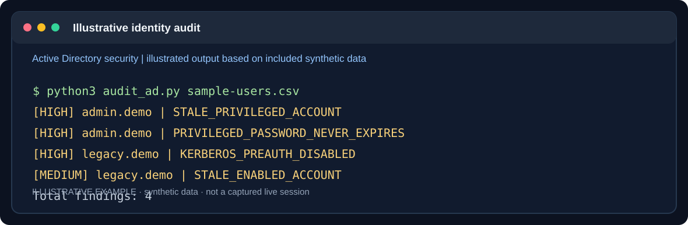

# Active Directory Identity Security Audit

**Category:** IAM / Windows Security / Identity Governance

A dependency-free Python analyzer for **sanitized, exported account inventory CSVs**. It flags risky combinations such as enabled privileged stale accounts, no password expiry, and Kerberos preauthentication disabled. The script does **not** connect to a domain controller, modify accounts, or verify effective group nesting.

## Run

```bash
cd projects/active-directory-security
python3 audit_ad.py sample-users.csv
python3 audit_ad.py sample-users.csv --json
python3 -m unittest test_audit_ad.py
```

### Required CSV columns
`sam_account_name,enabled,privileged,password_never_expires,preauth_required,last_logon_days_ago`

Boolean fields accept `true`/`false`. A `last_logon_days_ago` value of `-1` means unknown. Stale threshold: **90 days**. Each finding includes an evidence string and remediation recommendation.

### Example authorized export workflow
In a lab domain, an administrator can review `Get-ADUser` output and manually prepare the documented CSV schema. Do not publish actual user lists, SIDs, personal data, tokens, or credentials.

### Extend for a hiring-manager-quality project
- Create a read-only PowerShell exporter in a disposable AD lab.
- Add recursive privileged group membership resolution.
- Distinguish service accounts and break-glass accounts from human users.
- Record review exceptions and approval trails for access remediation.
- Validate remediation with before/after lab exports and measurable results.

**Limitations:** Directory exports can be stale, `lastLogonTimestamp` is approximate, and privileged membership must be reliably computed upstream. Findings are review candidates, not proof of compromise. Sample input is synthetic.


## Visual evidence and narrated workflow

This repository includes [three annotated visual examples](SCREENSHOTS.md) that explain the synthetic input, expected CLI findings, and analyst follow-up steps. They are **illustrations**, not captured evidence from a live environment.



## Complete documentation map

- [Architecture and data-flow design](ARCHITECTURE.md): how inputs, analysis, and output connect; plus trust boundaries and limitations.
- [Detailed findings report](FINDINGS.md): what the example flags, why it matters, and how to investigate or remediate.
- [Visual walkthrough](SCREENSHOTS.md): explanation of each illustration and instructions for recording authentic lab screenshots.
- [Portfolio-wide documentation guide](../DOCUMENTATION-GUIDE.md): exact purpose of each file and what work can truthfully be claimed.
- [Executable code](./audit_ad.py): implementation details and reproducible logic.

### Evidence statement

The packaged sample data is fabricated. The image above is an **illustrative terminal visualization**, not a real captured assessment screenshot. A true hands-on lab screenshot should be added only after executing and documenting that lab.


## Verified local execution evidence

The source code and bundled demonstration inputs were executed locally on **Python 3.13.5**, November 19, 2026 (US Eastern). These are genuine screenshots from an Xterm window showing the locally executed script output and test results. The input data remains **synthetic** and there was no access to production systems.


See [EVIDENCE.md](EVIDENCE.md) for exact commands, findings, reproducibility instructions, and limitations. Previously included SVG terminal images remain labeled illustrations and must not be confused with these captured screenshots.
