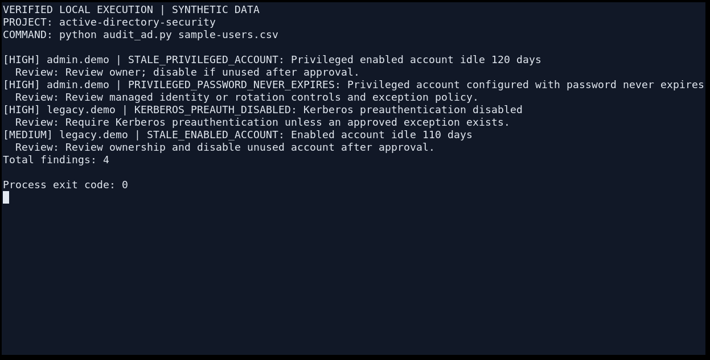
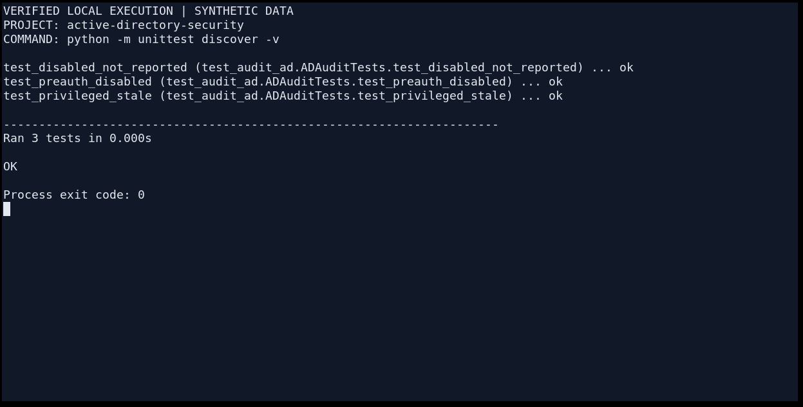

# Active Directory Identity Security Audit

**Category:** IAM / Windows Security / Identity Governance

A dependency-free Python analyzer for **sanitized, exported account inventory CSVs**. It flags risky combinations such as enabled privileged stale accounts, no password expiry, and Kerberos preauthentication disabled. The script does **not** connect to a domain controller, modify accounts, or verify effective group nesting.

## Run

```bash
cd projects/active-directory-security
python3 audit_ad.py sample-users.csv
python3 audit_ad.py sample-users.csv --json
python3 -m unittest test_audit_ad.py
```

### Required CSV columns
`sam_account_name,enabled,privileged,password_never_expires,preauth_required,last_logon_days_ago`

Boolean fields accept `true`/`false`. A `last_logon_days_ago` value of `-1` means unknown. Stale threshold: **90 days**. Each finding includes an evidence string and remediation recommendation.

### Example authorized export workflow
In a lab domain, an administrator can review `Get-ADUser` output and manually prepare the documented CSV schema. Do not publish actual user lists, SIDs, personal data, tokens, or credentials.

### Extend for a hiring-manager-quality project
- Create a read-only PowerShell exporter in a disposable AD lab.
- Add recursive privileged group membership resolution.
- Distinguish service accounts and break-glass accounts from human users.
- Record review exceptions and approval trails for access remediation.
- Validate remediation with before/after lab exports and measurable results.

**Limitations:** Directory exports can be stale, `lastLogonTimestamp` is approximate, and privileged membership must be reliably computed upstream. Findings are review candidates, not proof of compromise. Sample input is synthetic.


## Documentation and evidence

- [System architecture](ARCHITECTURE.md): data flow, trust boundaries, assumptions and technical limitations.
- [Security findings](FINDINGS.md): interpreted findings, risk, and recommended review or remediation.
- [Local evidence report](EVIDENCE.md): exact commands, execution results and honest scope statement.
- [Execution screenshots](SCREENSHOTS.md): genuine captured terminal output for the sample run and its tests.
- [Implementation](./audit_ad.py): Python analyzer and bundled tests.

## Verified local execution evidence

The source code and bundled demonstration inputs were executed locally on **Python 3.13.5**, November 19, 2026 (US Eastern). These are genuine screenshots from an Xterm window showing the locally executed script output and test results. The input data remains **synthetic** and there was no access to production systems.





See [EVIDENCE.md](EVIDENCE.md) for exact commands, findings, reproducibility instructions, and limitations. The original illustrative placeholder images have been removed and replaced with actual local execution captures.
