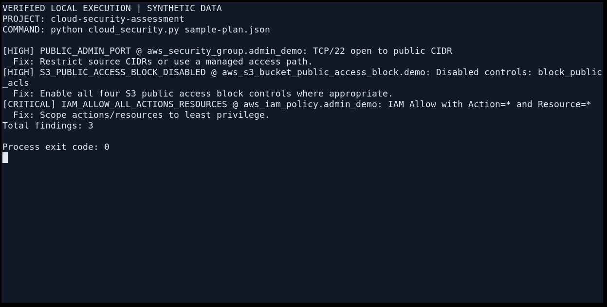
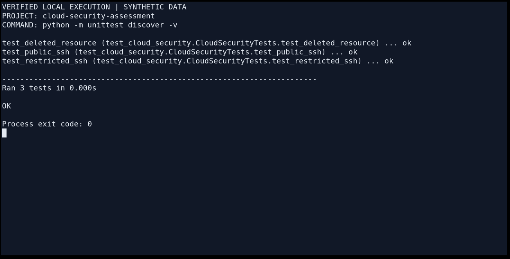

# Local Execution Evidence and Reproducibility

**Project:** cloud security assessment

**Capture date:** 2026-11-19 EST / 2026-11-20 UTC  
**Runtime:** Python 3.13.5, Linux terminal (Xterm/Xvfb), Python standard library only  
**Data classification:** Synthetic, non-sensitive fixtures  
**Scope:** Local command-line security prototype. No live external accounts, servers, or target systems were contacted.

## Setup

1. Clone or download the repository, then open the `projects/cloud-security-assessment` folder.
2. Verify that Python 3.10+ is installed with `python3 --version`.
3. Inspect `sample-plan.json` and `cloud_security.py` to understand input shape and how detections work.
4. Run the application and compare its output to the expected findings below.
5. Run the existing unit tests. No cloud credentials, administrator access, or networking is required.

## Commands executed

```bash
python3 cloud_security.py sample-plan.json
python3 -m unittest discover -v
```

## Actual local run: 3 reported records

A public SSH ingress path, a disabled S3 public-access-block setting, and an IAM allow-all statement were reported for the synthetic Terraform plan.

- The application process returned **exit code 0**.
- The **3 included unit tests passed** in the captured local run.
- This confirms only the included sample behavior and tests, **not comprehensive security coverage**.

## Terminal screenshots

### Real local program run



### Real local unit tests



The screenshots were captured from a terminal running the commands above. The images show an *actual local execution* using fabricated inputs, not an enterprise environment or deployed service. The main script was verified byte-for-byte against the corresponding GitHub blob before executing it.

## Review / interpretation

Read [FINDINGS.md](FINDINGS.md) for detection criteria and analyst-oriented remediation considerations, and [ARCHITECTURE.md](ARCHITECTURE.md) for the data-flow design. Re-running with the bundled sample is the simplest way to check the results; reviewing the test cases shows what is and is not validated.

## Limitations and next steps

- Do not infer real-world compromise, a live vulnerability, or effective access from sample-only findings.
- No actual cloud configurations, scanner exports, or domain controller inventory were accessed.
- No patches, permission changes, or cloud remediations were executed.
- For a full deployed lab, first create an isolated authorized environment, capture configuration before/after, attach sanitized authoritative evidence, and document all conclusions and false positives.
