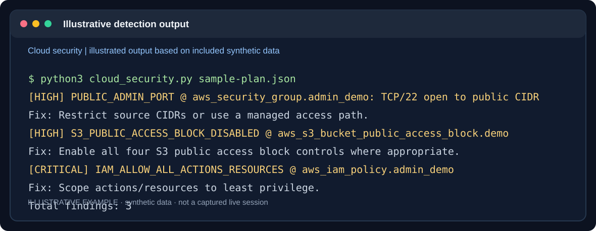

# Cloud Configuration Risk Analyzer

**Category:** Cloud Security / Infrastructure as Code / Security Engineering

A dependency-free Python tool that examines an AWS Terraform **plan JSON** and reports a selected set of high-risk configurations. This starter is a configuration checker, **not** a substitute for Checkov, AWS Config, or an audit of deployed cloud resources.

## Run

```bash
cd projects/cloud-security-assessment
python3 cloud_security.py sample-plan.json
python3 cloud_security.py sample-plan.json --json
```

Input format: the `resource_changes` array from `terraform show -json plan.out`. For each resource, the tool examines `change.after` (planned final state). It detects:
- EC2 security group ingress opening TCP 22 or 3389 to `0.0.0.0/0` or `::/0`
- S3 public access block resources where one or more of the four protective controls are explicitly false
- IAM policies with an `Allow` statement combining wildcard `Action` and wildcard `Resource`

The included synthetic sample has intentional findings. Never upload a real Terraform plan without removing sensitive values: plan JSON may contain credentials or other secrets.

## Extend for a hiring-manager-quality project

1. Add pytest or unittest coverage of valid/invalid Terraform schemas.
2. Compare findings against AWS Security Hub / CIS guidance and explain scope.
3. Add CI gating with a baseline and structured SARIF output.
4. Use Checkov in a **separate sandbox** to cross-check detection coverage.
5. Document false positives and remediations with before/after test artifacts.

## Limitations

Not all Terraform provider schemas are handled; many resources are not checked. This tool flags selected patterns, not a full cloud security assessment. The sample is fabricated and demonstrates the analyzer only.


## Visual evidence and narrated workflow

This repository includes [three annotated visual examples](SCREENSHOTS.md) that explain the synthetic input, expected CLI findings, and analyst follow-up steps. They are **illustrations**, not captured evidence from a live environment.



## Complete documentation map

- [Architecture and data-flow design](ARCHITECTURE.md): how inputs, analysis, and output connect; plus trust boundaries and limitations.
- [Detailed findings report](FINDINGS.md): what the example flags, why it matters, and how to investigate or remediate.
- [Visual walkthrough](SCREENSHOTS.md): explanation of each illustration and instructions for recording authentic lab screenshots.
- [Portfolio-wide documentation guide](../DOCUMENTATION-GUIDE.md): exact purpose of each file and what work can truthfully be claimed.
- [Executable code](./cloud_security.py): implementation details and reproducible logic.

### Evidence statement

The packaged sample data is fabricated. The image above is an **illustrative terminal visualization**, not a real captured assessment screenshot. A true hands-on lab screenshot should be added only after executing and documenting that lab.
