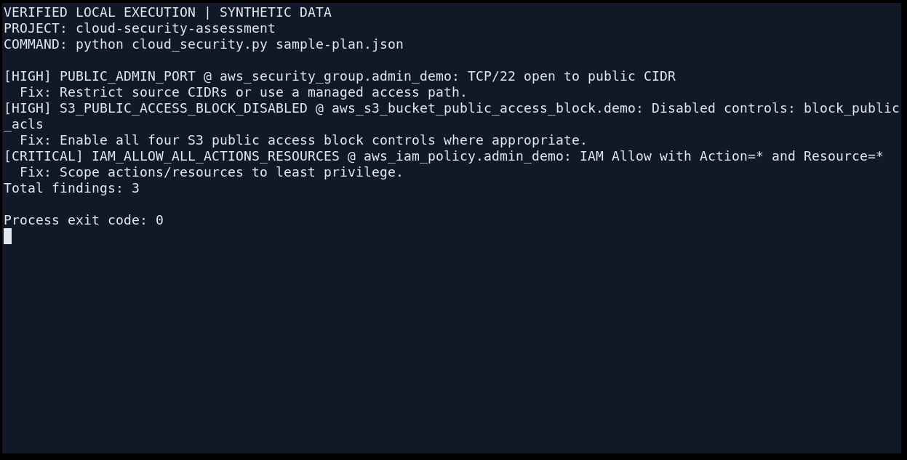
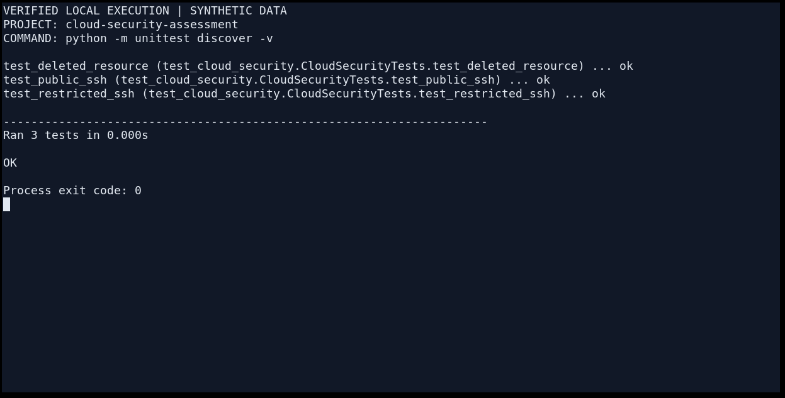

# Genuine Execution Screenshots (Local Synthetic Lab)

The two PNGs below are real captures of terminal windows generated while actually running the checked-in Python project and its unit tests against non-sensitive synthetic data. They **are not captures of live AWS accounts, corporate vulnerability scans, or Active Directory**.

## 1. Local execution

**Command:** `python3 cloud_security.py sample-plan.json`. The script completed with process exit code 0. A public SSH ingress path, a disabled S3 public-access-block setting, and an IAM allow-all statement were reported for the synthetic Terraform plan.

## 2. Unit test execution

**Command:** `python3 -m unittest discover -v` from the project directory. All 3 included unit tests passed in this execution.

## 3. Interpretation and repeatability

The screenshot text was captured from Xterm with Xvfb while running locally, not typed into an illustration. The same Python source matches the GitHub source blob; the test dataset is harmless, fabricated example data. See [EVIDENCE.md](EVIDENCE.md) and [FINDINGS.md](FINDINGS.md) for scope and findings. Only an authorized, separately documented lab can substantiate a claim of real cloud- or directory-security testing.

## What the screenshots prove—and what they don't

These screenshots demonstrate the actual local Python program and included unit tests executing on fabricated test input. They do not establish that an AWS account, enterprise vulnerability scanner or Active Directory forest was accessed. To document a deployed lab, capture and publish separate, sanitized evidence after obtaining authorization.
