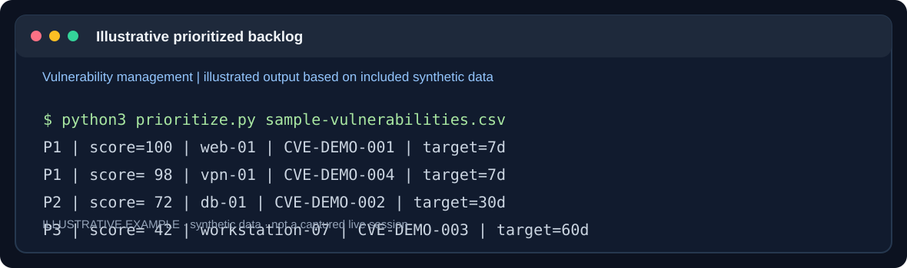

# Vulnerability Prioritization Engine

**Category:** Vulnerability Management / Risk Analysis / Security Engineering

An offline, standard-library Python application that ingests normalized vulnerability scan findings and creates an actionable remediation backlog. It implements a **documented project-specific score** (not official CVSS/EPSS/SSVC), with example SLA bands.

## Run

```bash
cd projects/vulnerability-management
python3 prioritize.py sample-vulnerabilities.csv
python3 prioritize.py sample-vulnerabilities.csv --output prioritized.csv
python3 -m unittest test_prioritize.py
```

### Required CSV columns
`asset,cve,cvss,criticality,internet_exposed,age_days,remediation`
- `cvss`: 0–10 numeric
- `criticality`: 1–5 integer; business-assigned rating
- `internet_exposed`: true/false
- `age_days`: nonnegative integer

### Risk model (illustrative)
`risk_score = min(100, round(cvss * 6 + criticality * 5 + (20 if exposed else 0) + min(age_days // 30, 5) * 2))`

| Score | Priority | Example target |
| --- | --- | --- |
| 85–100 | P1 | 7 days |
| 65–84 | P2 | 30 days |
| 40–64 | P3 | 60 days |
| 0–39 | P4 | 90 days |

SLA targets are example policy values, **not official standards**. This intentionally does not incorporate exploitability probabilities, asset reachability, compensating controls, or vulnerability-specific intelligence.

## Extend for a hiring-manager-quality project

Integrate an authorized Nessus/Greenbone CSV export parser; enrich with EPSS and CISA KEV; attach business ownership; track remediation status and exceptions; measure overdue findings and rescan verification; create a dashboard and real (sanitized) before/after evidence.

The included CSV is fabricated test data. No actual enterprise scanning or vulnerability remediation has been performed.


## Visual evidence and narrated workflow

This repository includes [three annotated visual examples](SCREENSHOTS.md) that explain the synthetic input, expected CLI findings, and analyst follow-up steps. They are **illustrations**, not captured evidence from a live environment.



## Complete documentation map

- [Architecture and data-flow design](ARCHITECTURE.md): how inputs, analysis, and output connect; plus trust boundaries and limitations.
- [Detailed findings report](FINDINGS.md): what the example flags, why it matters, and how to investigate or remediate.
- [Visual walkthrough](SCREENSHOTS.md): explanation of each illustration and instructions for recording authentic lab screenshots.
- [Portfolio-wide documentation guide](../DOCUMENTATION-GUIDE.md): exact purpose of each file and what work can truthfully be claimed.
- [Executable code](./prioritize.py): implementation details and reproducible logic.

### Evidence statement

The packaged sample data is fabricated. The image above is an **illustrative terminal visualization**, not a real captured assessment screenshot. A true hands-on lab screenshot should be added only after executing and documenting that lab.
