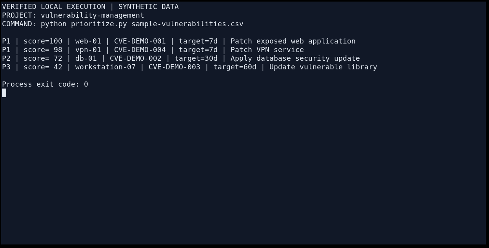
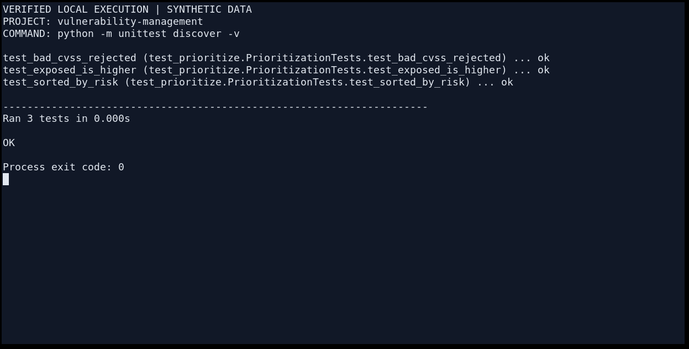

# Vulnerability Prioritization Engine

**Category:** Vulnerability Management / Risk Analysis / Security Engineering

An offline, standard-library Python application that ingests normalized vulnerability scan findings and creates an actionable remediation backlog. It implements a **documented project-specific score** (not official CVSS/EPSS/SSVC), with example SLA bands.

## Run

```bash
cd projects/vulnerability-management
python3 prioritize.py sample-vulnerabilities.csv
python3 prioritize.py sample-vulnerabilities.csv --output prioritized.csv
python3 -m unittest test_prioritize.py
```

### Required CSV columns
`asset,cve,cvss,criticality,internet_exposed,age_days,remediation`
- `cvss`: 0–10 numeric
- `criticality`: 1–5 integer; business-assigned rating
- `internet_exposed`: true/false
- `age_days`: nonnegative integer

### Risk model (illustrative)
`risk_score = min(100, round(cvss * 6 + criticality * 5 + (20 if exposed else 0) + min(age_days // 30, 5) * 2))`

| Score | Priority | Example target |
| --- | --- | --- |
| 85–100 | P1 | 7 days |
| 65–84 | P2 | 30 days |
| 40–64 | P3 | 60 days |
| 0–39 | P4 | 90 days |

SLA targets are example policy values, **not official standards**. This intentionally does not incorporate exploitability probabilities, asset reachability, compensating controls, or vulnerability-specific intelligence.

## Extend for a hiring-manager-quality project

Integrate an authorized Nessus/Greenbone CSV export parser; enrich with EPSS and CISA KEV; attach business ownership; track remediation status and exceptions; measure overdue findings and rescan verification; create a dashboard and real (sanitized) before/after evidence.

The included CSV is fabricated test data. No actual enterprise scanning or vulnerability remediation has been performed.


## Documentation and evidence

- [System architecture](ARCHITECTURE.md): data flow, trust boundaries, assumptions and technical limitations.
- [Security findings](FINDINGS.md): interpreted findings, risk, and recommended review or remediation.
- [Local evidence report](EVIDENCE.md): exact commands, execution results and honest scope statement.
- [Execution screenshots](SCREENSHOTS.md): genuine captured terminal output for the sample run and its tests.
- [Implementation](./prioritize.py): Python analyzer and bundled tests.

## Verified local execution evidence

The source code and bundled demonstration inputs were executed locally on **Python 3.13.5**, November 19, 2026 (US Eastern). These are genuine screenshots from an Xterm window showing the locally executed script output and test results. The input data remains **synthetic** and there was no access to production systems.





See [EVIDENCE.md](EVIDENCE.md) for exact commands, findings, reproducibility instructions, and limitations. The original illustrative placeholder images have been removed and replaced with actual local execution captures.
