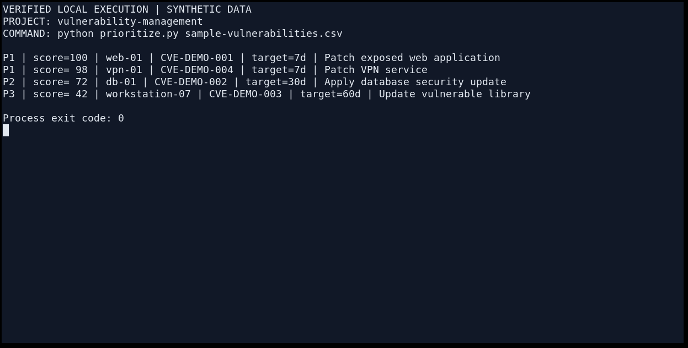
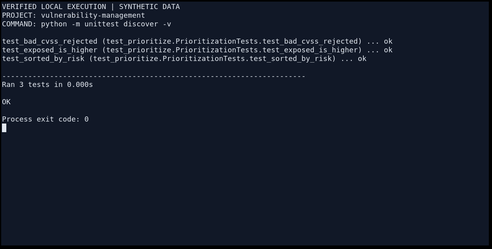
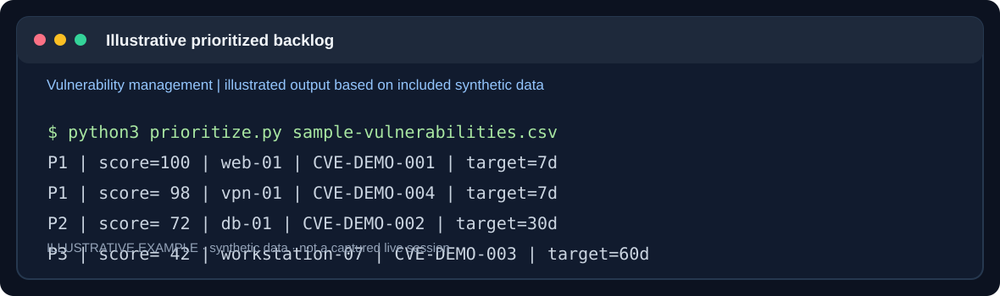

# Genuine Execution Screenshots (Local Synthetic Lab)

The two PNGs below are real captures of terminal windows generated while actually running the checked-in Python project and its unit tests against non-sensitive synthetic data. They **are not captures of live AWS accounts, corporate vulnerability scans, or Active Directory**.

## 1. Local execution

**Command:** `python3 prioritize.py sample-vulnerabilities.csv`. The script completed with process exit code 0. Four fictitious vulnerability rows were ranked in descending risk order: web-01 (100), vpn-01 (98), db-01 (72), workstation-07 (42).

## 2. Unit test execution

**Command:** `python3 -m unittest discover -v` from the project directory. All 3 included unit tests passed in this execution.

## 3. Interpretation and repeatability

The screenshot text was captured from Xterm with Xvfb while running locally, not typed into an illustration. The same Python source matches the GitHub source blob; the test dataset is harmless, fabricated example data. See [EVIDENCE.md](EVIDENCE.md) and [FINDINGS.md](FINDINGS.md) for scope and findings. Only an authorized, separately documented lab can substantiate a claim of real cloud- or directory-security testing.

---

## Previously prepared illustrative workflow diagrams

These terminal-style images are **illustrations of expected program behavior** derived from the bundled fabricated inputs, not photographs or captures of a real live scan or domain. The terminal screens make the workflows easier to inspect visually. The actual Python program is provided in this same directory for independent execution.

## 1. Inspect the source input

The first visual explains what the program reads and which fields matter for the security analysis. Open the corresponding `sample-*.json` or `sample-*.csv` file to inspect the actual input records.

## 2. Understand the expected analysis output

The second visual shows a condensed illustrative console transcript from the included input. Compare the rule names, risk classifications, and remediation suggestions with the program's actual output after running it yourself. These are **not** screenshots of a performed real-world assessment.

## 3. Review the analyst workflow

The third visual outlines what a human security analyst would do **after** reviewing a finding: validate the affected asset, assess policy exceptions, assign remediation, and independently verify the fix. This is a recommended process, **not** evidence those operational steps were carried out.

## Capture your own real execution evidence

1. In a local terminal, navigate to this project directory.
2. Run the command described in `README.md` using the supplied sample input.
3. Capture the terminal window showing the command, tool output, and system clock if appropriate.
4. Remove usernames, access keys, proprietary paths, IP addresses, and other private information before publishing.
5. Commit the capture with a descriptive date and clearly state whether the input was synthetic or from an authorized lab.

For an enterprise-grade demonstration, also include a separately captured remediation validation and accompanying scan/export evidence. Do not label illustrative visuals as actual terminal captures.
